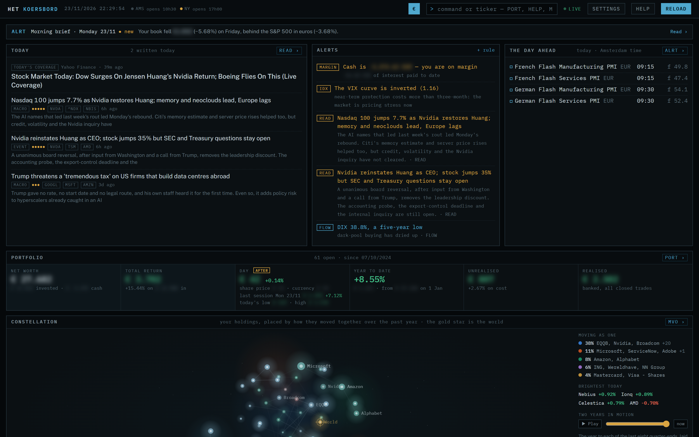
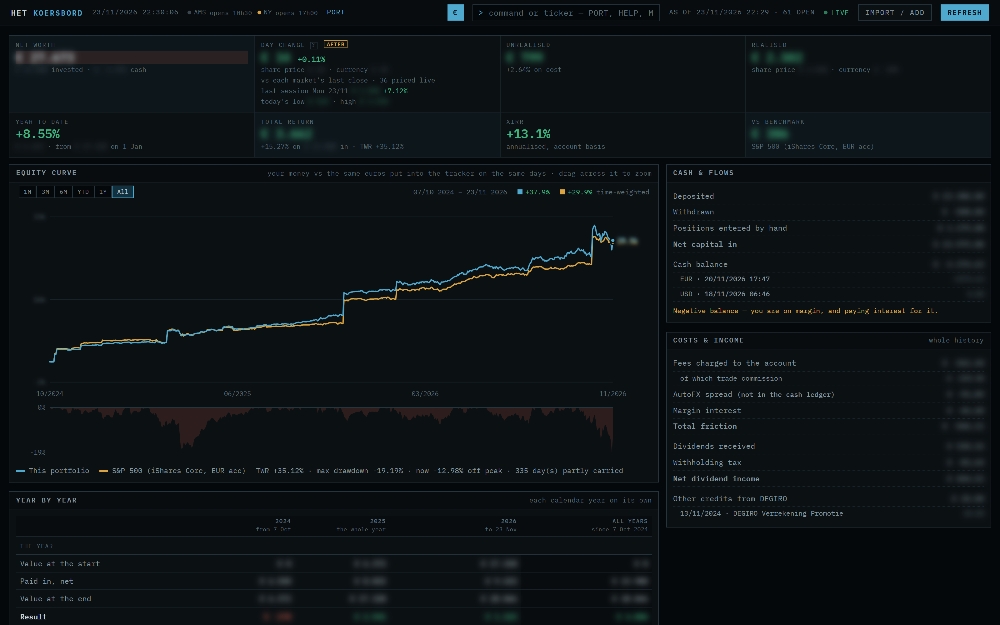
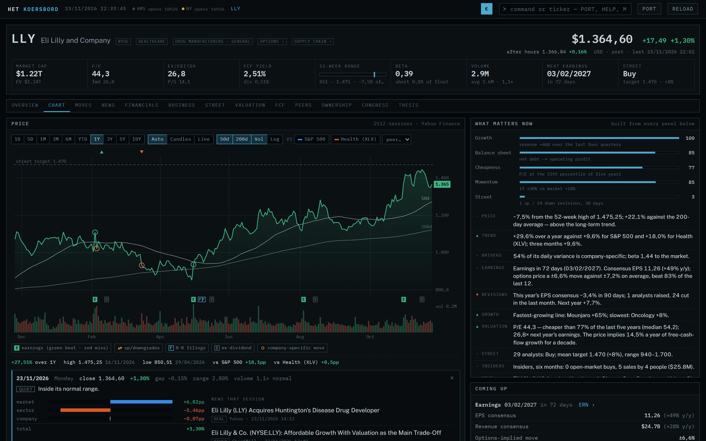
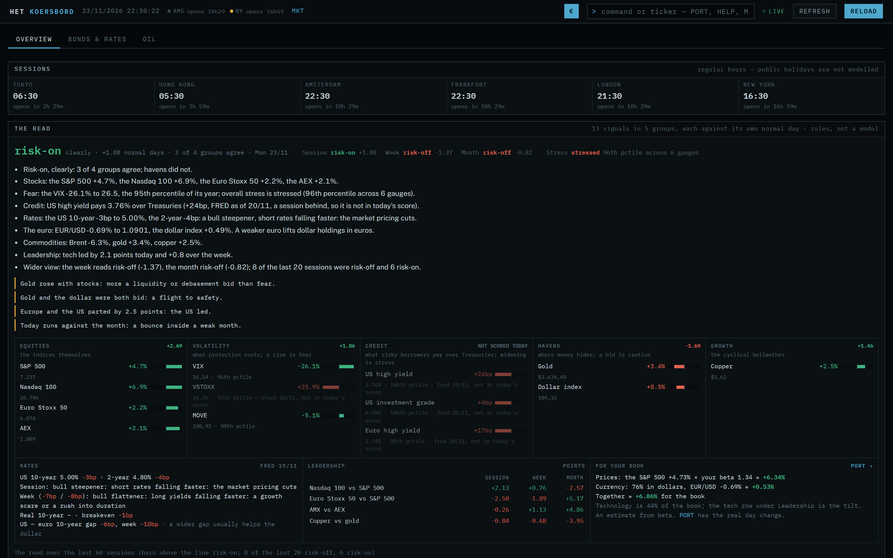
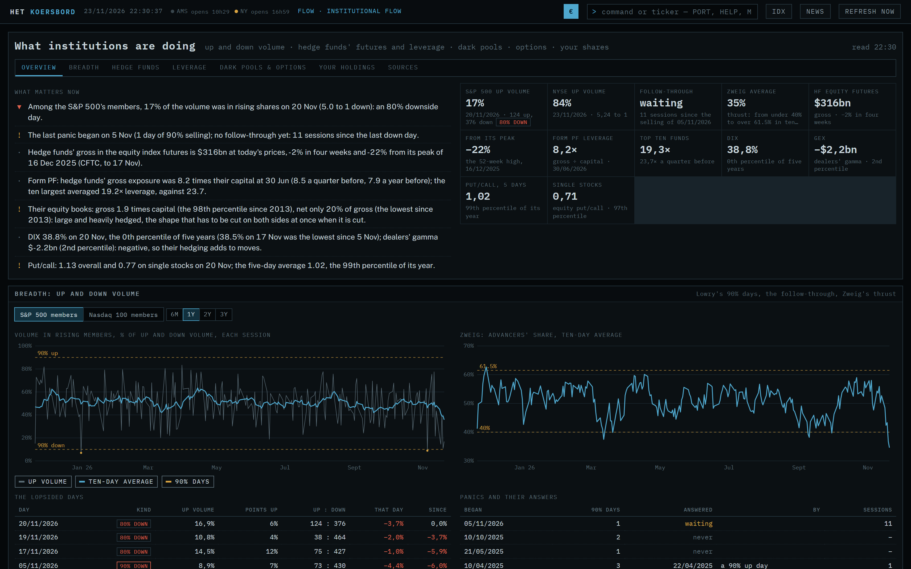
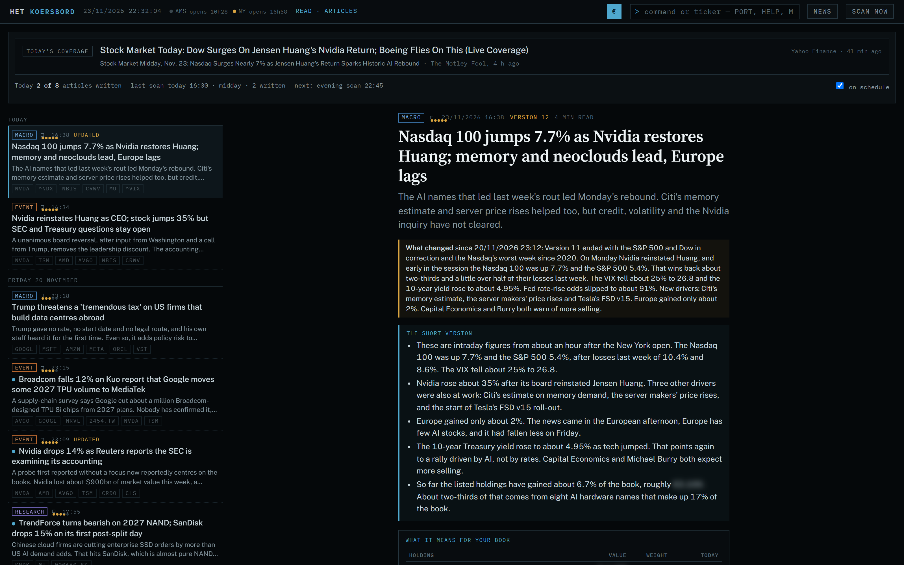
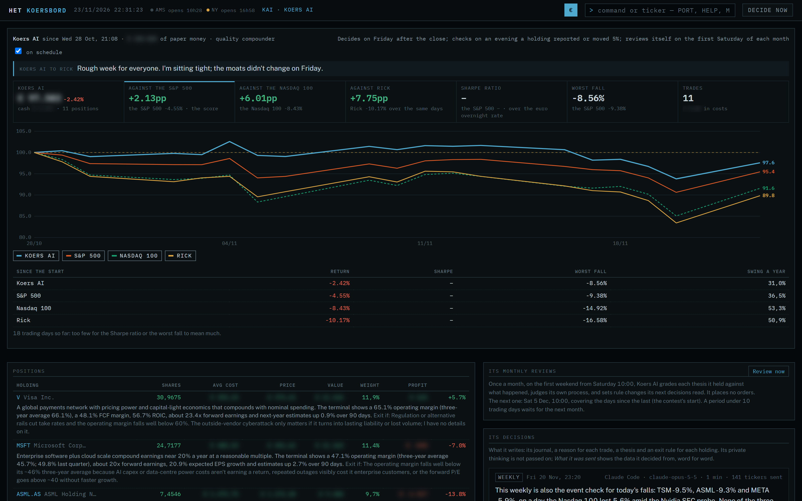
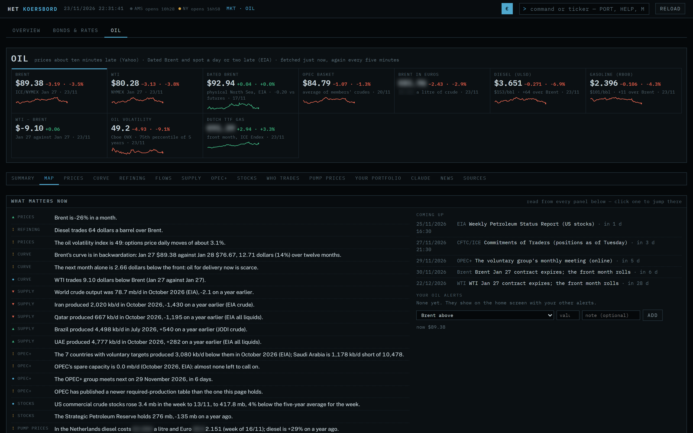

# Het Koersbord

A personal market terminal for a Dutch private investor, in the spirit of a
Bloomberg terminal. Each page has a short code (`MKT`, `ERN`, `FLOW`) that
you type in the command bar. It runs on one Windows laptop as a FastAPI
server with a SQLite database. Its ledger is built from the investor's DEGIRO
account exports, and it reads more than twenty free data sources. Claude
writes the briefs, earnings reports and articles.

Built and used daily since September 2026.

- **~49,000 lines of Python** in 57 modules, and **~21,000 lines** of plain
  HTML and JavaScript across some two dozen pages. There is no front-end
  build step.
- **269 checks** in `verify.py`, run against a copy of a real ledger. They
  cover accounting identities to the cent, the parsers, the schedulers and
  the alert rules.
- **No API key is required.** Optional keys are FRED, Finnhub, aisstream.io
  and Anthropic; Claude Code on a Claude plan can stand in for the last.



The screenshots are taken with the terminal's own blur switch on (`€` in the
bar, or Shift+B). It blurs every euro amount; percentages and market prices
stay readable.

---

## The pages

| Code | Page | What it does |
|---|---|---|
| `PORT` | Portfolio | The ledger, rebuilt from DEGIRO's Transactions and Account exports. Time-weighted return with deposits neutralised, the daily cash line, and year-by-year results that add up to the euro. Risk by holding, beta, VaR and expected shortfall. Turbo certificates are priced from the share they track. |
| `/t/…` | Stock page | Any symbol. Fundamentals from SEC XBRL filings in one currency and one share count, the analyst consensus and its history, the Street's view, financials, and a journal. |
| `MKT` | Market snapshot | Indices, rates, FX, commodities and volatility. Each day change resets at that market's own close; pre- and after-market moves are tagged. |
| `BOND` | Bonds & rates | Yield curves, the expected rate path, and what each bond fund would have done to the book's worst days. |
| `OIL` | Oil | Brent and WTI, OPEC's targets, inventories, and live tankers from AIS on a map and a globe. Also the book's sensitivity to oil. |
| `RRG` | Rotation | A relative rotation graph of sectors and holdings. |
| `OPT` | Options | Chains and greeks for the holdings, fifteen strategy templates, a premium screener, and Cboe's strategy-index history. |
| `SPLC` | Supply chain | Suppliers and customers read from companies' annual filings, with the sentences that say so. |
| `NEWS` | News | General, company and macro news: Finnhub with a free key, Yahoo's per-ticker feed without one. |
| `ERN` | Earnings | The week's reporters. The release is parsed for EPS and revenue against consensus, and Claude writes a report on it. |
| `GEO` | Geopolitics | Each risk is mapped onto the positions it touches, in euros. |
| `ALRT` | Morning brief | What happened overnight to the book and the markets, with a Claude note. |
| `WCH` | Watchlist | A nightly scan of about a thousand US and European companies for quality, dips and momentum, with the market's mood. |
| `MVO` | Markowitz & forecast | Mean-variance optimisation with your own views. A forecast that includes Dutch Box 3 tax under both today's system and the 2028 bill, drawn from 150 years of market history. |
| `EUR` | The euro | The rate gap, CFTC positioning, FX options and fair-value measures. What a move in EUR/USD does to the book. |
| `MAC` | Macro calendar | Releases with their actuals, and how EUR/USD and S&P 500 futures reacted in the minutes after. |
| `FCF` | FCF model | A free-cash-flow valuation with a CAPM default return, fading growth and a capped exit multiple. |
| `IDX` | Indices | An S&P 500 and Nasdaq 100 deep dive: every member, breadth, concentration and the forward P/E. |
| `READ` | Articles | An AI editor scans the news three times a weekday and writes up to eight articles a day. |
| `KAI` | Koers AI | A paper-trading contest. Claude manages €100,000 of paper money against the owner and the S&P 500, under fixed rules, and reviews itself monthly. |
| `POL` | Politicians' trades | US Congress members' trades from House and Senate filings, with scanned filings read by OCR. Built on the author's [politician-trading-tracker](https://github.com/RickArentsen/politician-trading-tracker). |
| `FLOW` | Institutional flow | Up and down volume, Lowry's 90% days, the Zweig breadth thrust, put/call ratios, short volume, dark-pool and gamma indices, CFTC and hedge-fund leverage. |
| `WEEK` | Week in review | Every Saturday: the book's week and what drove it, the markets, the week ahead, and a Claude note. |
| `SYS` | Health | Every background job, data source and the database. A job that has failed for a day puts a line on the home screen. |

### Screenshots

**Portfolio**: the equity curve against the same euros put into an S&P 500
tracker on the same days, with drawdown below.


**A stock page**: price against the street target with earnings, filings
and dividends marked, and what matters now, built from every panel.


**MKT**: the day's read across thirteen signals in five groups, each
measured against its own normal day.


**FLOW**: what institutions are doing. Up and down volume, Lowry's 90% days,
the Zweig thrust, hedge-fund leverage, DIX and gamma.


**READ**: the AI editor's articles, each with what changed since its last
version.


**Koers AI**: Claude's paper portfolio against the S&P 500, the Nasdaq 100
and the owner, with a thesis and exit rule for every holding.


**OIL**: prices, the curve, supply, OPEC+ and what matters now.


---

## How it is built

```
backend/
  portfolio_app.py   FastAPI app: the pages, the /api/pf routes, start-up jobs
  pf/                one module per page, plus the shared core:
    service.py         the ledger: positions, cash, flows, returns
    store.py           SQLite (WAL): tables, a cache that prunes and vacuums itself
    pricing.py, stream.py   Yahoo quotes and the live price stream
    sec.py             SEC XBRL company facts
    earnai.py          the one gateway to Claude (see below)
  static/            the pages: HTML and JavaScript, no framework, no build
  ptt/               the politician tracker, run as its own process
verify.py            269 checks
start-portfolio.bat  installs, starts and opens the terminal
```

- **One process, local only.** Background jobs run inside the server on
  their own schedules: the nightly watchlist scan, three article scans, the
  Saturday review, and the evening flow collection. Middleware refuses any
  request whose Host is not the laptop itself, and any cross-site write.
- **One gateway to Claude.** Every write-up goes through `pf/earnai.py`. It
  runs either Claude Code headless on the owner's Claude plan or the
  Anthropic API, always on one pinned model and effort. What each write-up
  was given is kept beside it. Koers AI's page shows, word for word, what
  each decision was made from. A check fails if any other module starts
  Claude itself or names a model.
- **A polite client.** Yahoo is asked one request at a time, with cooldowns
  when it pushes back. The SEC gets its required user agent. Everything
  that can be cached is cached.

## How it is tested

`verify.py` runs 269 checks against a copy of the real database. Most are
identities that must hold to the cent:
- net worth is securities plus cash;
- profit is net worth less the capital put in;
- each year's result splits into realised, unrealised, dividends and costs;
- the years chain into the time-weighted return.

The rest pin down behaviour with fixtures: earnings-release tables, market
sessions and holidays, schedulers, alert rules, the tax rules, and what the
AI is sent.

Each new check is proven by planting faults in a copy of the code, one at a
time, and confirming the check fails on every one.

Some of what the checks guard against, each found in real use:

- **A deposit is not a return.** An iDEAL payment is in the cash balance from
  the moment it is reserved, a day or two before DEGIRO books the deposit.
  Counting only the booked deposits read it as profit in between.
- **Closing times.** Amsterdam closes five and a half hours before New
  York, so a daily beta between them is biased. Regressions use five-day
  returns.
- **Release tables.** A column header such as "($ in billions, except
  earnings per share)" is not a heading for the rows below it, or revenue
  is read as EPS.
- **Turbos.** A turbo is priced from the share it tracks, its financing
  level and the currency, never as the share itself.

## Running it

Windows 10 or 11, Python 3.11 or newer. See [SETUP.md](SETUP.md) for the
install, importing your DEGIRO exports, the optional keys, and what each
background job needs.

It was built for one person's DEGIRO account. Anyone with DEGIRO exports
can run it, but nothing here is investment advice.

## Licence

All rights reserved. The code is published to be read; no licence to reuse
it is granted.

`backend/pf/fcst_seed.json` is derived from the Jordà–Schularick–Taylor
Macrohistory Database (CC BY-NC-SA 4.0) and Robert Shiller's data, and keeps
their terms. Data read from each source remains subject to that source's
terms.
